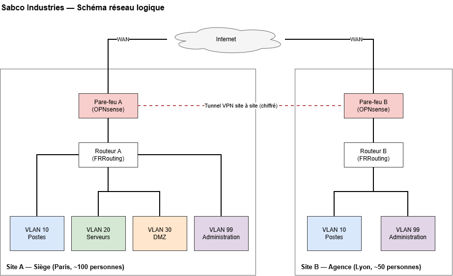

# SecureNet Lab

Ce dépôt rassemble un projet que j'ai réalisé en novembre 2026 : construire le réseau d'une entreprise fictive répartie sur deux sites, le sécuriser, l'attaquer moi-même, puis corriger les failles trouvées. Tout tourne en virtuel sur mon PC portable (16 Go de RAM).

J'ai voulu passer à la pratique en réseau et en cybersécurité, des sujets que j'avais surtout vus en cours pendant mon Master MIAGE à l'Université Paris Dauphine-PSL. En stage, je travaillais déjà sur l'identité (Active Directory, Entra ID, SSO) et sur la remise en conformité d'imprimantes en SNMPv3, mais je n'avais jamais monté un réseau complet moi-même.

## L'entreprise : Sabco Industries

Sabco Industries est une PME industrielle d'environ 150 personnes. Le siège, à Paris, accueille une centaine de personnes et héberge les serveurs, la DMZ et la sortie Internet. L'agence de Lyon compte une cinquantaine de personnes et est reliée au siège par un VPN.

Chaque site a son pare-feu OPNsense et son routeur FRRouting. À Paris, le réseau est découpé en quatre VLAN : postes (10), serveurs (20), DMZ (30) et administration (99). Lyon n'a que les postes et l'administration. Les adresses suivent la règle 10.site.VLAN.machine : par exemple 10.1.10.0/24 pour les postes de Paris et 10.2.10.0/24 pour ceux de Lyon.

## Ce que j'ai fait

**Dossier d'architecture.** Avant de toucher au lab, j'ai rédigé les besoins, le plan d'adressage, les zones de sécurité et une analyse de risques simplifiée inspirée d'EBIOS RM, avec sept risques notés selon leur gravité et leur vraisemblance. J'ai relié les mesures prévues au guide d'hygiène de l'ANSSI et à l'annexe A d'ISO 27001. Tout est dans [le dossier d'architecture](docs/dossier-architecture.md).

**Réseau multi-sites.** Dans GNS3, j'ai monté les switchs et les routeurs FRRouting (en conteneurs Docker), avec les VLAN, le routage OSPF entre les deux sites, et un DHCP et un DNS (dnsmasq) pour les postes. Les scripts qui remettent la configuration après un redémarrage sont dans le dossier `lab`.

**Pare-feu et VPN.** J'ai installé un OPNsense par site, directement dans VirtualBox. J'avais d'abord essayé de les faire tourner dans GNS3, mais la VM plantait : la virtualisation imbriquée et la RAM étaient trop justes sur mon PC. Les deux pare-feu sont reliés par un tunnel WireGuard. J'ai mis en place le NAT vers Internet, une DMZ qui ne peut pas joindre le réseau interne, et des règles entre les zones : les postes, par exemple, n'accèdent à la DMZ qu'en HTTP et HTTPS. Le détail est dans [partie3-pare-feu-vpn.md](docs/partie3-pare-feu-vpn.md).

**Identité et accès.** Sur un serveur Debian, j'ai déployé en Docker un annuaire OpenLDAP, Keycloak pour le SSO (OIDC) et FreeRADIUS. Keycloak et FreeRADIUS s'appuient tous les deux sur l'annuaire. Quand une application demande un jeton pour Alice, ce jeton contient son groupe (compta). La connexion à l'interface d'administration du pare-feu passe par RADIUS, avec les comptes de l'annuaire. Le détail est dans [partie4-identite.md](docs/partie4-identite.md).

**Attaque et corrections.** Depuis une machine Kali, j'ai scanné le réseau puis cherché des failles. J'en ai trouvé trois. Le pare-feu acceptait encore son mot de passe par défaut. La console Keycloak passait en HTTP, et j'ai pu lire un mot de passe en clair dans une capture réseau. Enfin, un ARP spoofing m'a permis de me placer entre le pare-feu et le serveur d'identité et d'intercepter un échange RADIUS. Pour chaque faille, j'explique la correction appliquée ou celle que je recommande dans [partie5-attaque-durcissement.md](docs/partie5-attaque-durcissement.md).

Les captures d'écran de chaque étape sont dans le dossier `docs/captures`.

## Ce que j'ai simplifié ou pas terminé

Je n'ai pas fait l'authentification 802.1X sur les ports filaires, trop difficile à reproduire en virtuel : RADIUS sert à l'administration du pare-feu. Je n'ai pas réussi à brancher Kali sur le VLAN des postes dans GNS3. L'attaque a donc été menée depuis le réseau d'administration, ce qui est moins réaliste qu'un poste compromis. Le passage de Keycloak en HTTPS est recommandé mais pas appliqué dans le lab, et les règles du tunnel WireGuard autorisent encore tout le trafic entre les sites.

Les mots de passe qui apparaissent dans les fichiers (comptes alice et bruno, secrets RADIUS) sont des mots de passe de lab, volontairement simples. Je ne publie pas l'export de configuration d'OPNsense, parce qu'il contient les clés privées du VPN : la configuration est décrite dans les documents et les captures.

## Ce que je retiens

Le plus formateur a été le dépannage. Il a fallu comprendre pourquoi KVM était indisponible (Windows gardait son hyperviseur actif), trouver un câble virtuel débranché grâce à une prise rouge dans OPNsense, et réaliser qu'une interface OPNsense bloque tout ce qui entre tant qu'aucune règle ne l'autorise. J'ai aussi vu concrètement que l'ordre des règles de pare-feu compte, et qu'un mot de passe envoyé en HTTP se lit en une commande.

## Outils utilisés

VirtualBox 7.2, GNS3 2.2, OPNsense 26.7, FRRouting 8.4, Debian 13, Docker, OpenLDAP (image osixia/openldap 1.5.0), Keycloak 26.0.8, FreeRADIUS, Kali Linux, nmap, tcpdump et arpspoof.

## Organisation du dépôt

Le dossier `docs` contient le dossier d'architecture, le schéma réseau (en image et au format draw.io), un document par partie et les captures d'écran. Le dossier `lab` contient les scripts de configuration des routeurs de Paris et de Lyon, le fichier qui crée les utilisateurs et les groupes de l'annuaire (`sabco.ldif`), et le script qui redéploie LDAP, Keycloak et FreeRADIUS.

## Relancer le lab

Je démarre d'abord la VM GNS3 seule dans VirtualBox, puis j'ouvre GNS3. Une fois les routeurs lancés, j'attends environ une minute trente que FRRouting soit prêt, puis j'exécute le script du site (`frr-paris.sh` ou `frr-lyon.sh`, puis la version partie 3). Je démarre ensuite les deux VM OPNsense, et enfin le serveur d'identité, sur lequel `docker start ldap keycloak radius` relance les trois services.

Sabana Suresh
