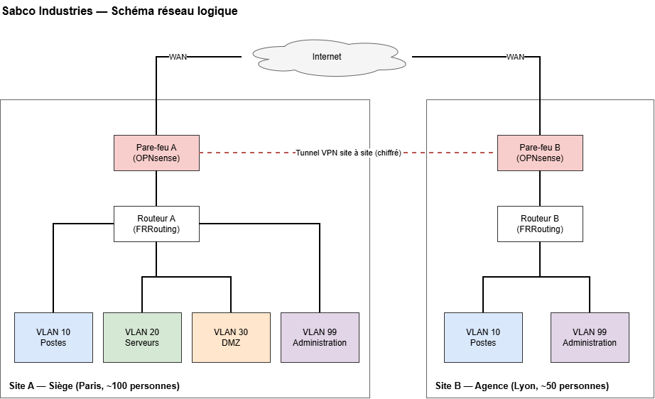

# Dossier d'architecture – SecureNet Lab

Ce projet consiste à monter en laboratoire le réseau d'une entreprise fictive à deux sites, à le sécuriser, puis à tester sa sécurité en simulant des attaques et à corriger les failles trouvées.

## 1. Présentation de l'entreprise

Sabco Industries est une PME industrielle fictive d'environ 150 salariés, répartis sur deux sites :

- **Site A – Siège (Paris)** : environ 100 personnes. On y trouve le service informatique, les serveurs internes, la zone exposée à Internet (DMZ) et la sortie Internet de l'entreprise.
- **Site B – Agence (Lyon)** : environ 50 personnes, reliée au siège par un VPN site à site.

## 2. Besoins

| Réf. | Besoin | Type |
|---|---|---|
| B1 | Les deux sites partagent les mêmes outils et fichiers, comme s'ils étaient sur un même réseau | Métier |
| B2 | Le site vitrine de l'entreprise est accessible depuis Internet | Métier |
| B3 | Les salariés en télétravail accèdent aux ressources internes de façon sécurisée | Métier |
| B4 | Les postes, les serveurs internes et le serveur exposé à Internet sont séparés | Sécurité |
| B5 | Chaque salarié a un seul compte pour accéder aux applications (SSO), avec un second facteur sur les accès sensibles | Sécurité |
| B6 | Seules les personnes autorisées administrent le pare-feu et les équipements réseau | Sécurité |
| B7 | Les équipements sont surveillés et les événements de sécurité sont enregistrés | Sécurité |
| B8 | Une panne ou une attaque est repérée rapidement | Exploitation |
| B9 | L'infrastructure peut être redéployée à l'identique | Exploitation |

## 3. Architecture réseau

Le schéma source est disponible dans [schema-reseau-sabco.drawio](schema-reseau-sabco.drawio).

- Chaque site a son **pare-feu** (OPNsense), qui sert de point d'entrée et de sortie du réseau.
- Un **tunnel VPN site à site** chiffré relie les deux pare-feu.
- Derrière chaque pare-feu, un **routeur** (FRRouting) échange les routes entre les sites avec le protocole OSPF.
- Chaque type de machine est placé dans son propre **VLAN** :

| VLAN | Zone | Contenu |
|---|---|---|
| 10 | Postes | Ordinateurs des salariés |
| 20 | Serveurs | Annuaire, SSO, supervision (siège uniquement) |
| 30 | DMZ | Site vitrine exposé à Internet (siège uniquement) |
| 99 | Administration | Administration des équipements réseau |

Le site B ne contient que les VLAN 10 et 99 : les serveurs et la DMZ sont centralisés à Paris.

Le choix de l'équipement qui filtre les échanges entre VLAN sera précisé lors de la mise en place du pare-feu.

## 4. Plan d'adressage

On utilise la plage privée `10.0.0.0/8`. Les adresses suivent la règle `10.site.VLAN.machine` : le deuxième nombre indique le site (1 = Paris, 2 = Lyon) et le troisième le numéro de VLAN. Exemple : `10.1.20.15` est un serveur (VLAN 20) du siège.

**Réseaux des sites**

| Zone | Site | Réseau | Passerelle |
|---|---|---|---|
| Postes | A (Paris) | 10.1.10.0/24 | 10.1.10.1 |
| Serveurs | A | 10.1.20.0/24 | 10.1.20.1 |
| DMZ | A | 10.1.30.0/24 | 10.1.30.1 |
| Administration | A | 10.1.99.0/24 | 10.1.99.1 |
| Postes | B (Lyon) | 10.2.10.0/24 | 10.2.10.1 |
| Administration | B | 10.2.99.0/24 | 10.2.99.1 |

**Liens entre équipements**

| Lien | Réseau |
|---|---|
| Pare-feu A ↔ Routeur A | 10.0.1.0/30 |
| Pare-feu B ↔ Routeur B | 10.0.2.0/30 |
| Tunnel VPN (A ↔ B) | 10.255.0.0/30 |
| Internet (A ↔ B) | 203.0.113.0/29 |

La plage `203.0.113.0/24` est réservée par les normes à la documentation : elle ne risque pas d'entrer en conflit avec un vrai réseau et joue le rôle des adresses publiques.

## 5. Zones de sécurité

Chaque zone a un niveau de confiance. Le pare-feu applique une règle simple : tout ce qui n'est pas explicitement autorisé est refusé.

| Zone | Niveau de confiance | Rôle |
|---|---|---|
| Internet | Aucun | Réseau extérieur, non maîtrisé |
| DMZ (VLAN 30) | Faible | Héberge le site vitrine, exposé à Internet |
| Postes (VLAN 10) | Moyen | Ordinateurs des salariés |
| Serveurs (VLAN 20) | Élevé | Annuaire, SSO, supervision |
| Administration (VLAN 99) | Très élevé | Administration des équipements réseau |

**Flux autorisés** (tout le reste est refusé) :

| De | Vers | Autorisé |
|---|---|---|
| Internet | DMZ | HTTPS vers le site vitrine uniquement |
| Postes | Internet | Navigation web (HTTP, HTTPS) et DNS |
| Postes | Serveurs | Applications nécessaires (annuaire, SSO) |
| Administration | Tous les équipements | Accès d'administration (SSH, HTTPS) |
| Site B | Site A | Via le tunnel VPN, mêmes règles que les postes du site A |
| Télétravail | Serveurs | Via VPN, après authentification avec second facteur |

Aucun flux n'est autorisé de la DMZ vers les zones internes : si le site vitrine est compromis, l'attaquant ne peut pas rebondir vers les serveurs.

## 6. Analyse de risques (EBIOS RM simplifiée)

### Ce qu'on protège

- Les données et fichiers de l'entreprise
- Les comptes et les identités des salariés
- La disponibilité de la liaison entre les deux sites et des services internes
- L'image de l'entreprise (site vitrine)

### D'où viennent les menaces

- Un attaquant externe qui cherche une faille exposée sur Internet
- Un poste de salarié compromis (hameçonnage, mot de passe volé) ou une erreur interne

### Scénarios

La gravité (G) et la vraisemblance (V) sont notées de 1 (faible) à 4 (forte). Le niveau est le produit G × V. Ces notes sont des estimations pour le cas fictif.

| Réf. | Scénario | G | V | Niveau | Mesures prévues |
|---|---|---|---|---|---|
| R1 | Intrusion par le site vitrine, puis rebond vers les serveurs | 4 | 3 | 12 | DMZ isolée, filtrage strict, mises à jour |
| R2 | Poste compromis, puis déplacement vers les serveurs | 4 | 3 | 12 | Séparation en VLAN, filtrage, comptes à droits limités |
| R3 | Vol d'identifiants ou attaque sur le SSO | 4 | 3 | 12 | Second facteur (MFA), limitation des tentatives, journalisation |
| R4 | Usurpation sur le réseau local (ARP spoofing) | 3 | 3 | 9 | Dynamic ARP Inspection, port security |
| R5 | Interception des échanges entre les deux sites | 3 | 2 | 6 | VPN chiffré |
| R6 | Prise de contrôle des équipements réseau | 4 | 2 | 8 | VLAN d'administration, authentification centralisée (RADIUS) |
| R7 | Attaque non détectée | 3 | 3 | 9 | Supervision, journaux centralisés, détection d'intrusion |

Ces scénarios servent de base à la partie « attaque et correction » du projet : chaque attaque simulée en lab est reliée à l'un de ces risques.

## 7. Correspondance avec l'ANSSI et ISO 27001

| Mesure du projet | Guide d'hygiène ANSSI (thème) | ISO 27001:2022 (Annexe A) |
|---|---|---|
| Séparation en VLAN et DMZ | Sécuriser le réseau | 8.22 Cloisonnement des réseaux |
| Filtrage par le pare-feu (refus par défaut) | Sécuriser le réseau | 8.20 Sécurité des réseaux, 8.21 Sécurité des services réseau |
| VPN site à site et télétravail | Gérer le nomadisme, sécuriser le réseau | 8.24 Cryptographie, 6.7 Travail à distance |
| SSO et second facteur | Authentifier et contrôler les accès | 5.16 Gestion des identités, 5.17 Authentification, 8.5 Authentification sécurisée |
| VLAN d'administration et RADIUS | Sécuriser l'administration | 8.2 Droits d'accès privilégiés, 5.15 Contrôle d'accès |
| Supervision SNMPv3 | Superviser, auditer, réagir | 8.16 Surveillance |
| Journaux centralisés et détection | Superviser, auditer, réagir | 8.15 Journalisation, 8.16 Surveillance |
| Configuration versionnée et redéployable | Connaître le système d'information, maintenir à jour | 8.9 Gestion de la configuration |
| Tests d'attaque puis corrections | Superviser, auditer, réagir | 8.8 Gestion des vulnérabilités techniques |
